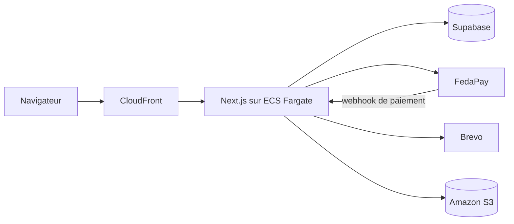

# FORGE IA — Plateforme de formation

https://github.com/user-attachments/assets/83f2c6fc-96b5-428f-99dd-0cefcbf3c029

**FORGE IA** est la plateforme web qui vend et fait vivre une formation en présentiel au Bénin : apprendre à
créer des sites, des applications et des SaaS avec l'IA, sans savoir coder, puis à les vendre.

Elle couvre tout le parcours, de la publicité jusqu'au certificat : page d'accueil, inscription et paiement
Mobile Money, espace élève, suivi pédagogique et tableau de bord du formateur. Elle fonctionne aussi bien sur
mobile que sur ordinateur.

**Site en ligne : [www.forgeia.site](https://www.forgeia.site)**

## Fonctionnalités

### Pour les visiteurs

- Page d'accueil pensée pour la publicité : programme, tarifs, compte à rebours, places par classe et FAQ.
- Inscription en deux minutes : compte avec e-mail et mot de passe, choix de la classe, puis préinscription
  payée par Mobile Money ou carte via FedaPay.
- Classes limitées en places : une classe complète n'est plus proposée.

### Pour les élèves

- Programme séance par séance, avec les leçons, les défis et les ressources de chaque séance.
- Tests (quiz) avec correction et suivi de progression.
- Dépôt des projets et retour noté du formateur.
- Bibliothèque de ressources : fichiers, codes, prompts et dossiers Google Drive.
- Paiement des échéances en ligne et reçus imprimables.
- Boutique de modèles de sites, payés en coins.
- Avis sur la formation, publiés après validation.
- Lien du groupe WhatsApp de la cohorte, affiché seulement après la préinscription.

### Pour le formateur

- Liste des inscrits, suivi des paiements et gestion des accès.
- Éditeur de programme : leçons en Markdown avec aperçu en direct, images et réorganisation.
- Gestion des tests, du calendrier des séances et de la liste de préparation.
- Publication de ressources, avec e-mail aux élèves en option.
- Correction des projets et modération des avis.
- Alertes à chaque inscription et à chaque paiement, par e-mail et sur Telegram.

## Stack technique

| Domaine | Outils |
|---|---|
| Application | Next.js 16 (App Router), React 19, TypeScript, Tailwind CSS v4 |
| Données | Supabase (PostgreSQL) |
| Paiements | FedaPay (Mobile Money et carte) |
| E-mails et alertes | Brevo, Telegram |
| Fichiers | Amazon S3, Google Drive |
| Hébergement | AWS : conteneur ECS Fargate derrière CloudFront, décrit avec AWS CDK |
| Tests | Vitest |



## Démarrer en local

Il faut Node.js 22 et npm.

```bash
npm install
cp .env.example .env.local
npm run dev
```

Ouvre ensuite [http://localhost:3000](http://localhost:3000).

Renseigne `.env.local` selon ce que tu veux tester. Sans Supabase, seule la page d'accueil fonctionne. Sans
les autres clés, l'application passe en mode démo : le paiement est simulé en local, et les e-mails et
alertes s'affichent dans la console au lieu d'être envoyés.

| Commande | Rôle |
|---|---|
| `npm run dev` | Serveur de développement |
| `npm run build` | Build de production |
| `npm start` | Lance le build de production |
| `npm test` | Tests (Vitest) |
| `npm run lint` | Vérification ESLint |

## Variables d'environnement

Toutes les variables sont listées et commentées dans [`.env.example`](.env.example).

| Variables | Rôle | Obligatoire |
|---|---|---|
| `NEXT_PUBLIC_SUPABASE_URL`, `NEXT_PUBLIC_SUPABASE_ANON_KEY`, `SUPABASE_SERVICE_ROLE_KEY` | Base de données | Oui, hors page d'accueil |
| `ADMIN_EMAIL`, `ADMIN_PASSWORD_HASH`, `ADMIN_SESSION_SECRET` | Connexion au tableau de bord (voir [`deploy/admin-auth.md`](deploy/admin-auth.md)) | Pour l'admin |
| `FEDAPAY_SECRET_KEY`, `FEDAPAY_ENV`, `FEDAPAY_WEBHOOK_SECRET` | Paiements | En production |
| `BREVO_API_KEY`, `EMAIL_FROM` | E-mails | En production |
| `TELEGRAM_BOT_TOKEN`, `TELEGRAM_CHAT_ID` | Alertes du formateur | Non |
| `GOOGLE_CLIENT_ID`, `GOOGLE_CLIENT_SECRET`, `GOOGLE_DRIVE_FOLDER_ID`… | Bibliothèque Google Drive | Non |
| `UPLOADS_BUCKET`, `AWS_REGION` | Fichiers sur S3 (sinon sur le disque local) | Non |

En production, les secrets sont stockés dans AWS Secrets Manager. Ils ne sont jamais versionnés.

## Gérer la formation

- **Contenu des cours** : leçons, tests, séances et liste de préparation se modifient dans le tableau de bord
  (`/admin`). La base de données fait foi : modifier un fichier du dépôt ne change pas le cours.
- **Cohorte en cours** : dates, prix, échéances, créneaux, lieu et FAQ se règlent dans
  [`src/lib/config/formation.ts`](src/lib/config/formation.ts).
- **Pages légales** : l'éditeur et la date de mise à jour sont dans
  [`src/lib/config/legal.ts`](src/lib/config/legal.ts).
- **Image de partage** (aperçu sur Facebook et WhatsApp) : sa source HTML et la commande pour la régénérer
  sont dans [`scripts/og-image/`](scripts/og-image/og-image.html).

## Base de données

Le schéma est décrit par les migrations SQL de [`supabase/migrations/`](supabase/migrations). La migration
`006_formation_adapt.sql` a servi à remplir le premier programme : il ne faut pas la réappliquer, elle
écraserait les modifications faites depuis l'admin.

## Déploiement

Chaque push sur `main` lance le workflow GitHub Actions **Déploiement AWS** :

1. tests de l'application ;
2. build de l'image Docker et envoi sur Amazon ECR ;
3. mise à jour du service ECS avec AWS CDK (dossier [`infra/`](infra)).

Le site est servi par CloudFront sur [www.forgeia.site](https://www.forgeia.site).

## Structure du dépôt

```text
src/app/          pages et routes API (accueil, inscription, espace élève, admin)
src/components/   composants d'interface
src/lib/          logique métier : configuration, données, paiements, e-mails, accès
supabase/         migrations SQL
infra/            infrastructure AWS (CDK)
scripts/          scripts utilitaires (image de partage, mot de passe admin…)
docs/             spécifications et plans de conception
```

## Auteur

Conçu et développé par **Christian GUEGUELIGUE**, fondateur de GUELICHWEB.

- Portfolio : [gchristian.online](https://gchristian.online)
- GitHub : [krissiankg](https://github.com/krissiankg)

© 2026 GUELICHWEB. Tous droits réservés.
